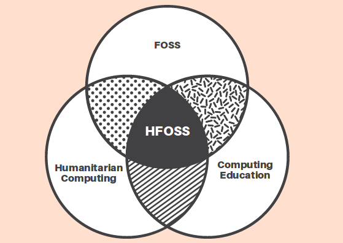

# Reflections on POSSE 2026

Last week I had the opportunity to attend the [Professors' Open Source Software Experience](https://teachingopensource.org/) (POSSE) workshop. The workshop was held at Red Hat in Raleigh, NC — a place I know well from my graduate school years at NC State and two summer internships at Red Hat — and focused on incorporating Humanitarian Free and Open Source Software (HFOSS) projects into computing curriculum. It was a great experience, and the three-day workshop gave me plenty to think about as I plan revise the courses I teach, including our undergraduate software engineering course (CS3704: Intermediate Software Design and Engineering) this fall, hoping to make them more practically relevant and engaging for students.

---

## Day 1 — Pedagogy and the Path to HFOSS Proficiency

The first day centered on **why** and **how** to use HFOSS in the classroom.

### Why HFOSS?

- Working on real open-source projects gives students authentic experience with version control, documentation, teamwork, and communication — skills they will use after graduation.
- The humanitarian mission (software with positive social impact) is a powerful motivator, especially for students who do not see themselves in traditional CS roles.

Research also shows contributing to open-source projects can help increase student alignment with industry concepts [Saha2026].

### Key Challenges

We also discussed key challenges

| Challenge | Impact |
|-----------|--------|
| Few clear on-ramps for students | Hard to find good first issues |
| Unpredictable project schedules | Mismatch with semester timelines |
| Instructor expertise | Steep learning curve, unfamiliar tooling |
| Assessment | No established rubric for grading contributions |

### The Four-Step Path

An interesting aspect was the four-step framework for integrating OSS and HFOSS into courses:

1. **Skills** — technical (git, code review) and professional (communication, teamwork) foundations.
2. **Kits** — frozen, containerized snapshots of real projects so students can experiment without fear.
3. **TOS Projects** — faculty-curated open-source projects with real client needs.
4. **HFOSS** — students contribute to live upstream projects.

This was helpful to show there are other ways to incorporate OSS concepts without throwing students into real-world project. The workshop provided practical resources for teaching HFOSS skills, including the [learning activities](https://teachingopensource.org/Category:Learning_Activity) and [kits](https://teachingopensource.org/Kits) which are ready to be integrated in classrooms. We got hands-on experience with before and during the workshop with [GitKit](https://teachingopensource.org/GitKit), a kit focused on teaching fundamental GitHub skills through an interactive Runestone book and Codespaces. 

---

## Day 2 — Projects, Teaching Style, and Tools

### Spotlighted TOS Projects

We covered three teaching-focused open-source projects led by instructors that are ready to integrate into courses:

- **FarmData2** — agricultural data collection
- **LibreFoodPantry** — software to support campus food pantries
- **OpenEnergyDashboard** — energy visualization for sustainability curricula

### Rethinking the Instructor Role

One of the most valuable conversations was about shifting from **lecturer** to **mentor**. In an HFOSS classroom, the instructor does not (and cannot) have all the answers. The goal is to model how to navigate uncertainty — a skill students will rely on in industry. We discussed explicitly setting expectations: *"This class will feel different. You will not always have a clear answer. That is the point."*

A highlight was the discussion of [**POGIL**](https://cspogil.org/) (Process-Oriented Guided Inquiry Learning) — an evidence-based approach where students work in structured teams and the instructor acts as a facilitator rather than a lecturer. I will aim to incorporate these types of activities more in my courses.

### AI in the HFOSS Classroom

Several emerging tools and policies were debated:

- **CodeHelp.app** — captures student process rather than just final output, helping instructors understand *how* students reach solutions.
- **Policy fragmentation** — different institutions and states have widely varying AI policies, making it hard to design portable activities.
- **Equity concerns** — ensuring AI does not widen gaps for students with less access or guidance.

There were several brief discussions on open-source tools to integrate in classroom settings. For instance, while not every student can afford a premium subscription to Claude Code, open-source tools like [opencode](https://opencode.ai/) may be asuitable and free replacement. However, institutions will differ on policies related to tool and model usage with regard to commercial access, usage with students' data, etc.

### Licensing

A brief note: an IP lawyer guest lecture (or a curated video) could demystify the licensing landscape for students.

---

## Day 3 — Project Evaluation

The final day was brief but focused on a practical skill: **quick project health checks**. We discussed evaluating repos for license, recent activity, maintainer responsiveness, and community tone. A recurring idea was to partner with a local nonprofit, turning campus HFOSS efforts into a genuine civic engagement loop. There was also unconference time available for participants to make practical plans for integrating HFOSS into courses. A summary of my takeaways are presented below.

---

## Takeaways

My goal is to integrate HFOSS and OSS concepts into all SE-related classes I teach going forward. The classes I teach have required students to start a new project from scratch, which allows them to gain experience with the full software development lifecycle (requirements, design, implementation, testing, maintenance), yet does not reflect the majority of real-world software engineering work. 

Some things I will use for this fall include:
1. **Starting small.** I will introduce mini-projects and workshops in CS 3704 this fall — a low-stakes way for students to experience the open-source workflow before joining a live project. I already use an [SE Basics](https://github.com/chbrown13/labspace-se-basics) workshop which provides an overview of git commands. Other small activities to consider include GitKit-style exercises and OSS-focused events like [HacktoberFest](https://hacktoberfest.com/), the [National Day of Civic Hacking](https://nationaltoday.com/national-civic-day-hacking/), and others.
2. **Reducing lecture content.** Lecturing is useful for conveying key information to students, but insufficient for providing engaging and practical learning experience. Based on student feedback from previous semester, it also tends to be their least favorite parts of courses. I will explore incorporating more activities and POGIL assignments in class, providing opportunities for students to learn on their own and from each other. I will also be explicit with students about the non-lecture, navigate-uncertainty-together approach on the first day of class.
3. **Adopting open-source tools.** AI-assisted development tools are becoming standard in practice, but many popular options require paid subscriptions that not all students can afford. I will integrate free and open-source alternatives (e.g., opencode, Claude Code with local models, or other free-tier LLM code assistants) into CS3704 so that every student can gain experience with AI-supported development without requiring a credit card. I am also exploring ways to automate scaffolding for agents and skills to have the focus on tool usage rather than overcoming installation, setup, and environment configuration challenges.

I am looking forward to putting some of these ideas into action this fall! Long-term, I hope to partner with local community organizations and non-profits to discuss software solutions that meet the needs of members of our community that could be supported and maintained in a classroom setting. This would probably be beyond the scope of CS3704, but could fit as a capstone or special topics course.

---
**References**
[Saha2026] Utsab Saha, Jeffrey D'Andria, and Tyler Menezes. "The open source resume: How open source contributions help students demonstrate alignment with employer needs." Proceedings of the 57th ACM Technical Symposium on Computer Science Education V. 1. 2026.