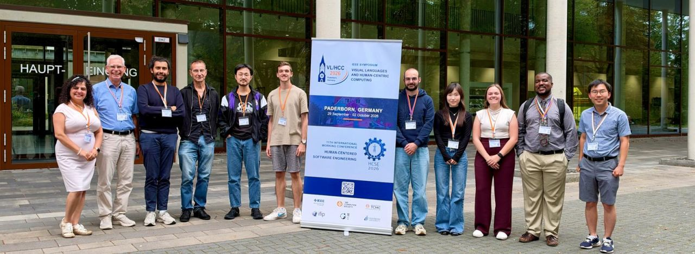

# VL/HCC 2026 Overview

This year we had the opportunity to attend the IEEE Symposium on Visual Languages and Human-Centric Computing ([VL/HCC 2026](https://conf.researchr.org/home/vlhcc-2026)) and the IFIP International Working Conference on Human-Centered Software Engineering (HCSE 2026) conferences in Paderborn, Germany. This post summarizes the contributions from our research group to these conferences.

**AutoTrack: Automated Variable‑Value Tracking for Novice Programmers [VL/HCC Graduate Consortium; Posters, Demos, & Showpieces]**

Minhyuk Ko

* :mag: **Problem:** Debuggers are essential for understanding program execution, especially as code grows more complex and AI-generated. Variable‑value tracking is a core debugging tasks, yet automated debugging tools lack usability and are too complex to support programmers---especially beginners.

* :test_tube: **Study:** Min proposed a novel tool, `AutoTrack`, that integrates affordances to enhance the usability of variable tracking during debugging tasks. He also proposed a user study design to evaluate the tool's effectiveness for supporting novice programmers. 

> This work was presented as a full talk for the VL/HCC graduate consortium, as well as a lightning talk and poster for the Posters, Demos, & Showpieces track!

**Graduate Consortium Co-Chair [VL/HCC]**

Chris Brown

I was the Graduate Consortium Co-chair, which was a very rewarding experience. The Graduate Consortium offered student participants (n = 5) valuable opportunities to enhance their presentation skills and receive constructive feedback on their research from peers and a panel of experts. This platform will provide a space for students to obtain external support for their research projects. The theme for this year was ``Human-centricity in the Era of Generative AI'', and we had [engaging presentations and discussions](https://conf.researchr.org/track/vlhcc-2026/vlhcc-2026-graduate-consortium?#event-overview) on aspects of human-AI collaboration and interactions in debugging, code reviews, data analysis, and discrimination testing. I am grateful for all of the panelists, students, and attendees who participated.
 

**Integrating Log-Based Fraud Detection in Agile Workflows: A Real-World Experience Report [HCSE]**

Arpit Thool, Chris Brown

* :mag: **Problem:** Modern software is increasingly developed using rapid releases processes (e.g., Agile and CI/CD) and distributed on the web, facing consistent threats and security attacks. Existing security analysis tools secure software across static and dynamic techniques, yet _log-based fraud detection_ uses logged events to detect suspicious behaviors and prevent incidents that security analysis tools cannot detect.

* :test_tube: **Study:** We provide an experience report outlining the experience of a real-world development team integrating log-based fraud detection (via Splunk and Grouper) into their software services after a real-world security incident. The paper outlines the experience, collects insights from development team members (n = 7) through qualitative interviews, and reports lessons learned from their expriences.

* :bar_chart: **Findings:** `Our findings show practitioners were willing to adopt log-based fraud detection and reported minimal disruption to day-to-day development activities, yet remained concerned with long-term maintenance, communicating and acting on alerts, and risks of false positives.

* :bulb: **Implication:** We discuss technical aspects as well as cultural and social aspects to consider for teams considering integrating log-based fraud detection tooling into their software services and workflows.

[[pre-print](https://arxiv.org/abs/2605.00352), [slides](https://docs.google.com/presentation/d/19uKLH5JHgpvKj57XvMLeGtNhGK7B9vqfe2ZUAC6HyBA/edit?usp=sharing)]

VL/HCC 2026 was a great experience, and the positive feedback from the community was encouraging. We're looking forward to building on these efforts and exploring new collaborative opportunities. If you'd like to learn more or contribute to these initiatives, we'd love to hear from you.